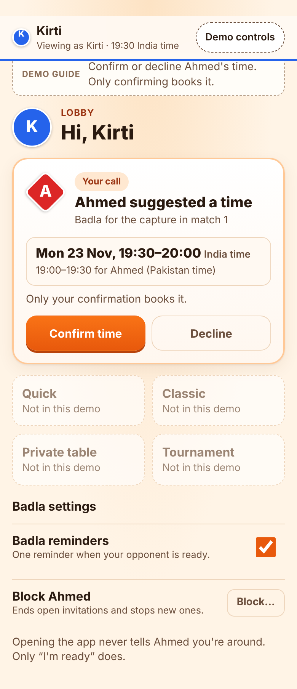
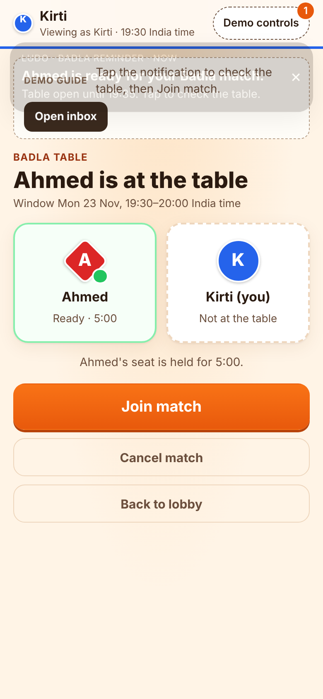
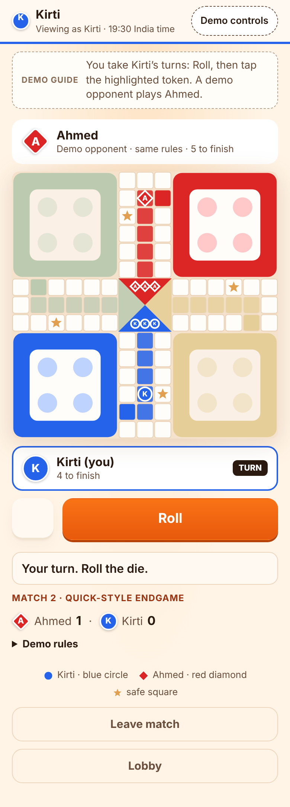
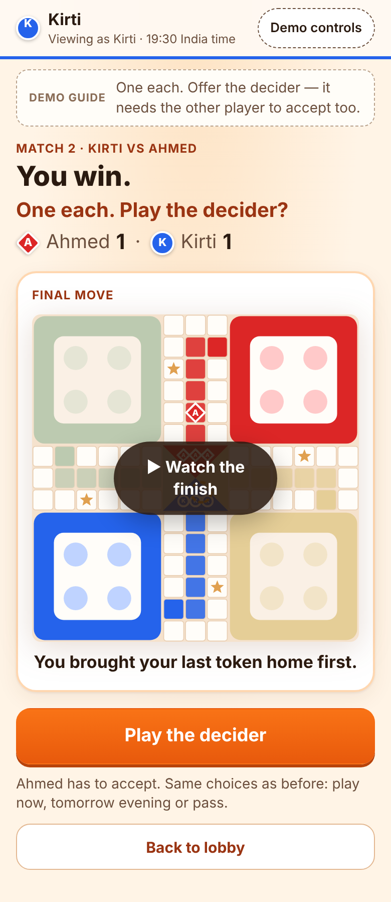

# Badla for Ludo STAR: playable concept

**Badla** is a return match that both players agree to. When a close 1v1 ends, the player who was caught can attach that one capture to an invitation. The opponent can play now, choose a time tomorrow evening, or pass. If they agree, both players come back, play the match, and the head-to-head score updates.

This repo is a **single-device case-study demo**. It has two fictional accounts (Kirti and Ahmed), a demo clock you can control and a local notification inbox. You don't sign in, invite anyone, grant permissions or wait until tomorrow. It doesn't use external APIs or any Gameberry systems. It is not the live game, and the in-app demo controls say so ("Playable concept").

| Original result | Ahmed's invitation | Kirti confirms | Reminder | Rematch | One each |
|---|---|---|---|---|---|
|  |  |  |  |  |  |

## Commands

Requires Node 20+ (tested on Node 22).

```bash
npm install          # install
npm run dev          # dev server at http://localhost:5173
npm run typecheck    # TypeScript, no emit
npm test             # Vitest (domain, board, persistence, UI)
npm run build        # typecheck + production build into dist/
npm run preview      # serve dist/
npm run e2e          # browser walkthrough (needs a running server and the `playwright` package)
```

`dist/` uses relative asset paths, so any static host (or a phone's browser) can open it.

## The guided story (about 3 minutes)

1. **Kirti, 22 Nov, 19:30 India time.** "Ahmed wins." with *Ahmed 1 · Kirti 0*. The hero card replays the capture from earlier in that match: *"Ahmed caught your last token just before safety."* Tap **Ask for Badla**.
2. The lobby card reads *"You challenged Ahmed."* with Withdraw and Watch replay. The **Demo guide** bar offers **Try Ahmed's view**.
3. **Ahmed** sees *"Kirti wants a rematch"* with the same capture from his side ("You caught Kirti's last token…"), shown on a board rotated to his seat. He picks **Tomorrow evening**: 19:00–19:30 Pakistan time, which Kirti sees as 19:30–20:00 India time.
4. Back with **Kirti**, she taps **Confirm time**. Only her confirmation books the match.
5. **Advance to agreed time.** Ahmed taps **I'm ready**. Kirti gets one simulated reminder: *"Ahmed is ready for your Badla match."* Tapping it rechecks the state and opens the shared table. Then **Join match**.
6. **Quick-style endgame.** You play Kirti's turns, and a labelled demo opponent plays Ahmed's turns with the same rules. With the guided seed, Kirti wins.
7. **"One each. Play the decider?"** with *Ahmed 1 · Kirti 1*. The decider needs Ahmed to accept again. Choose Play now for him, and Kirti joins match 3.

**The Play now path** uses no clock controls. Ahmed taps Play now, which marks him ready and opens a 5-minute table. Kirti joins from the notification or dismisses it with "Not now".

## Demo controls

The **Demo controls** button sits top right. Its badge shows the active identity's unread notifications.

- **View as Kirti / Ahmed.** Both views read the same stored state. The active identity always shows in the header.
- **Opponent response: Guided / Manual.** Guided shows a handoff prompt when the next move belongs to the other player. It never acts for that player: you tap every choice yourself. Manual shows no prompts.
- **Clock.** The demo clock runs in real time from 22 Nov 2026, 14:00 UTC. Buttons: *Advance to agreed time*, +5 min, +1 h, +1 day. Each advance rechecks expiries.
- **Notification inbox.** Local entries keyed by invitation ID.
- **Dice for the next match.** *Guided seed (2, 3, 2)* or *Fresh dice*. This is locked while a match is running.
- **Motion.** System, Reduced or Full.
- **Reset demo.** Restores the original state: Ahmed's single recorded win and nothing else.
- **Event log.** Output from the analytics adapter, with active player-days. It lives only in the demo controls and players never see it.

## Choices made for the demo only

- **Two fictional, eligible accounts on one device.** Production would authenticate both players and check Game Buddy and 1v1 eligibility.
- **Reconstructed screens.** The result screen, lobby and match handoff are plausible reconstructions, not the real Ludo STAR layout. All artwork is original SVG, and fonts are system fonts.
- **Quick-style endgame instead of Quick mode.** Each side starts with three tokens home and one token in its own protected lane. Kirti needs exactly 4 and Ahmed exactly 5. Kirti moves first, with one die per turn and no extra turns. A roll that overshoots passes the turn and the screen explains why. Finished tokens stay visible in the centre.
  - The guided seed runs Kirti 2, Ahmed 3, Kirti 2, so Kirti wins.
  - *Fresh dice* uses a seeded RNG (mulberry32) whose state is saved after every roll.
  - Seed **5** is the tested alternate: Kirti rolls 5 and overshoots, then Ahmed rolls exactly 5 and wins.
- **Fixed score order.** Every view lists *Ahmed · Kirti* (`SCORE_ORDER`), matching the brief's first-screen copy.
- **Board geometry.** The board is the conventional 15 × 15 cross with a 52-square loop. Where the arms meet the centre, the track takes the usual diagonal step at each corner, and `validateRoute` allows only that diagonal. Safe squares are the four start squares and four stars, at loop indices 0, 8, 13, 21, 26, 34, 39 and 47.
- **The capture fixture** (`src/board/replay.ts`):
  - Kirti (blue) is on route square 50. That is her last shared-track square, and the next step is her protected lane.
  - Ahmed (red) starts on his square 21 and rolls a 3 through 22 and 23 to 24. That lands on the same loop square from behind.
  - The engine test replays this through `applyMove` and checks each claim:
    - the destination is shared and unprotected;
    - Kirti's single token is the only one there;
    - Ahmed's other tokens are off the track.
  - The capture happened earlier in the match, before Ahmed's win.
- **Replay copy is derived from the event data.** "last token" and "just before safety" appear only when the stored event supports them. A finishing move reads "brought … last token home first". The replay plays from a stored snapshot and never changes live state or the record.
- **Notifications are in-app simulations.** Each player gets at most one readiness reminder per invitation. A reminder is suppressed when the recipient has muted reminders, when the pair is blocked, when the invitation is closed or when it would be a duplicate. Opening the app never notifies anyone.
- **Persistence is versioned `localStorage`** (`badla-demo`). The snapshot is validated before it is restored. If it fails, the app offers a reset and doesn't overwrite the saved data until you choose to.

## Rules implemented

- **Challenge lifecycle.** States run `pending → proposed → scheduled → waiting → playing → completed`. Play now goes straight from `pending` to `waiting`.
- **Terminal states.** These are `declined`, `withdrawn`, `expired`, `cancelled`, `missed`, `blocked`, `abandoned` and `completed`. A terminal invitation can't be revived, including from a stale notification.
- **Permissions.** Only the invitee can play now, propose a time or pass. Only the challenger can confirm, decline or withdraw. Either player can cancel a booked match before it starts.
- **Invitation limits.** Each completed match gets one invitation, and only one invitation can be open at a time. A new invitation for the same match is allowed only after a no-fault outcome: missed, an agreed window nobody used, or an abandoned match.
- **Time.** Windows are stored as UTC instants and formatted with `Intl.DateTimeFormat` in each player's zone. Intervals include the start and exclude the end.
  - Pending invitations expire after 24 h.
  - Proposals expire after 24 h or at the window start, whichever comes first.
  - A seat is held for 5 minutes or until the window ends, whichever comes first. A player can mark ready again while the window is open.
  - If a window closes with one player ready, the card says "You missed each other". There is no score change.
- **Matches.** Both players joining while their readiness overlaps creates exactly one match. A result is recorded once per match ID. Double taps, stale rolls, refreshes, repeated completions and abandoned matches can't add a win.

## Code map

| Part | File(s) |
|---|---|
| Domain reducer (transitions, permissions, clock, score) | `src/domain/reducer.ts`, `selectors.ts`, `types.ts` |
| Time and zones | `src/domain/time.ts` |
| Board geometry, movement, dice, replay frames | `src/board/geometry.ts`, `engine.ts`, `dice.ts`, `replay.ts` |
| Notification adapter | `src/domain/notifications.ts` |
| Analytics adapter | `src/domain/analytics.ts` |
| Persistence | `src/persistence/storage.ts` |
| Screens | `src/ui/screens/*` (Result, Lobby, Invite, Table, Match, Rivalry) |
| Store, navigation, demo guide | `src/ui/store.ts`, `navigation.ts`, `guide.ts` |
| Tests | `src/**/*.test.ts(x)`, `e2e/journey.cjs` |

**Analytics.** Each committed player action logs exactly one `player` event; Ahmed's scripted moves log as `demo-opponent`. Consequences are logged as `system` events, such as a reminder delivered or suppressed, an expiry, both players joining, a completed match or an accepted decider. Demo controls log as `demo` and replay views as `replay`. Dates use UTC. `activePlayerDays` counts distinct (player, date) pairs from player actions. A reminder, an acceptance and a match on the same date count as one active day.

## Production handoff (not built here)

- Authenticate both players, and take the capture and result from the authoritative match log.
- Store agreed UTC windows server-side, check readiness again at join, and hand the private pair to the existing Quick matchmaking.
- Use idempotent writes keyed by challenge and match IDs, and decide reminder eligibility on the server, respecting mute, block and online-status privacy.
