# Badla: turn a capture into a rivalry

A concept prototype for a Ludo social loop. **Concept prototype, not affiliated with Gameberry.** All artwork is original SVG, nothing leaves the device, every "AI" output is a deterministic function, and the gold figures are proposed pilot values.

A capture in a public match creates a rival. The player who was sent home takes **Badla**, a first-to-two series. They can play now, or let **Smart Fixture** book a time when both players usually play. At 1-1 the decider can be private or a four-player **Grudge Night** that clubmates follow and predict. The guided demo takes a first-time reviewer from the public match to the series result in about four minutes, without opening Demo controls.

| Home | The capture | Result + Badla card | Smart Fixture | Lock-screen push | Booked |
|---|---|---|---|---|---|
| 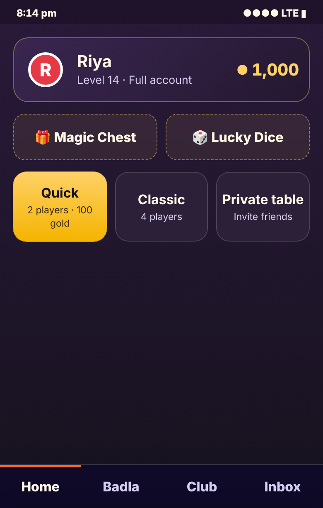 | 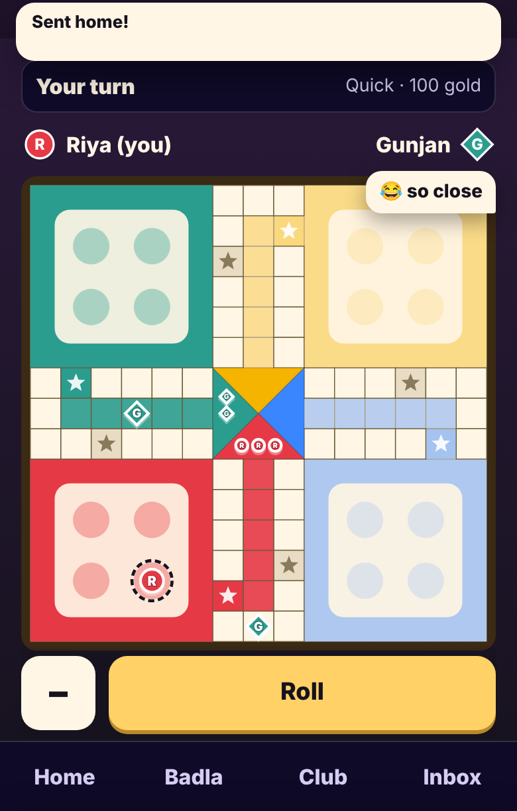 | 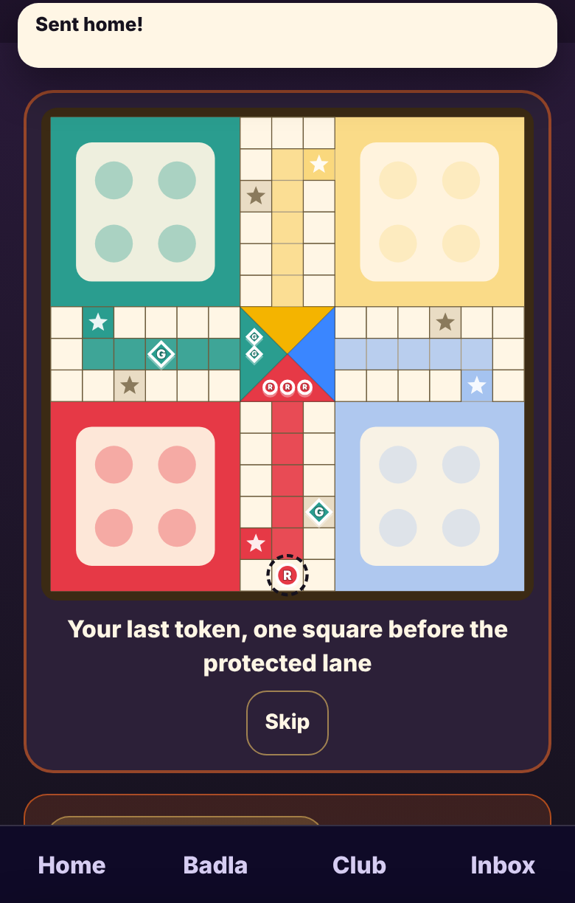 | 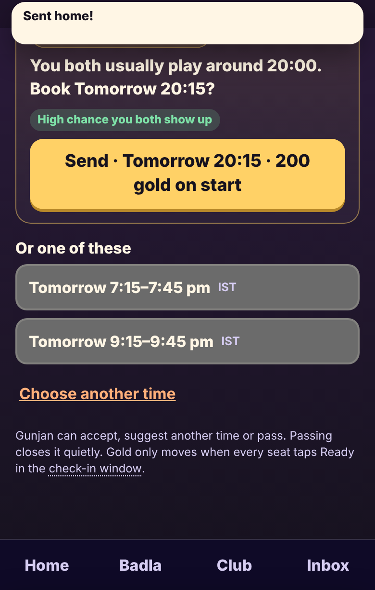 | 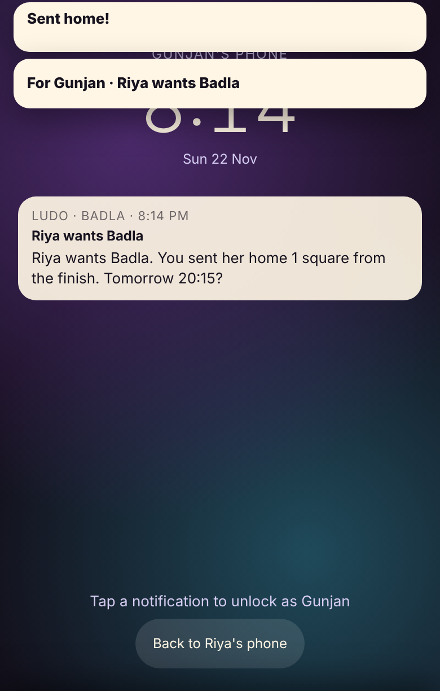 | 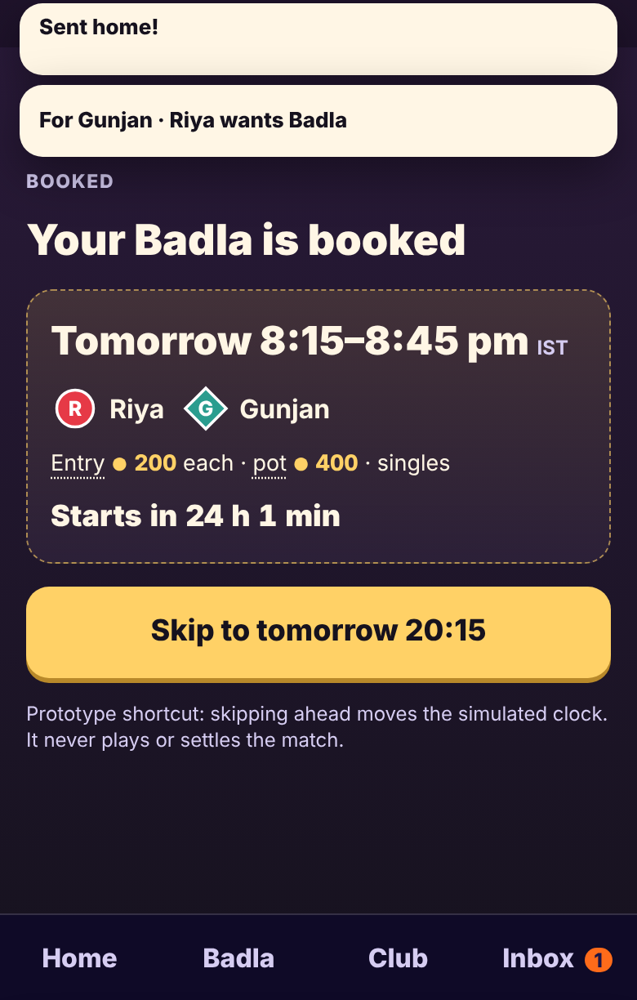 |
| **1-1: three options** | **Club card (Dev)** | **Series end** | **Desktop: phone + Model panel** | **Welcome** | |
| 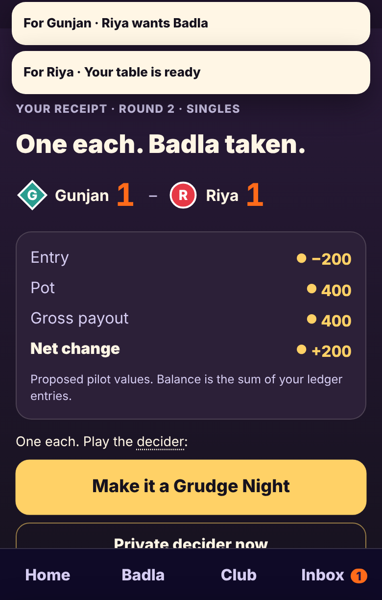 | 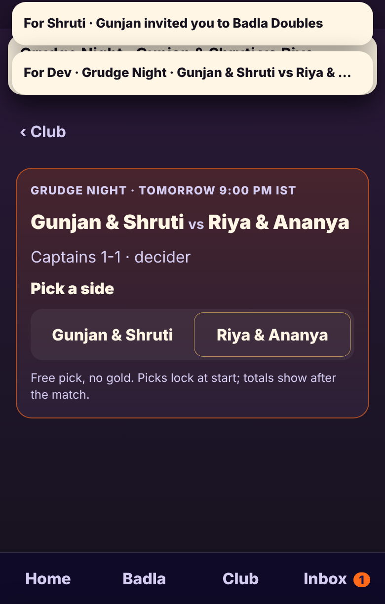 | 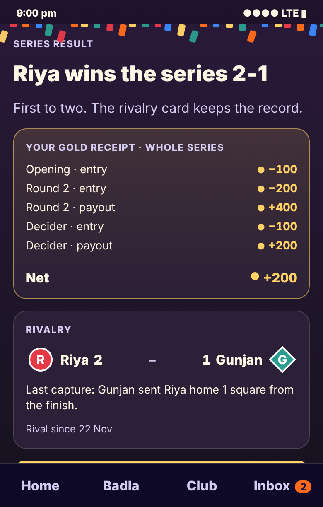 | 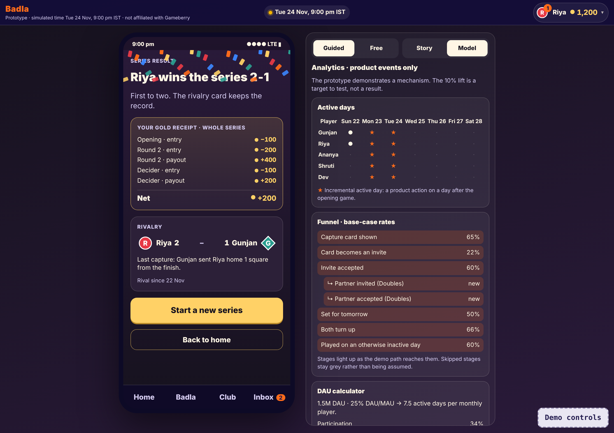 | 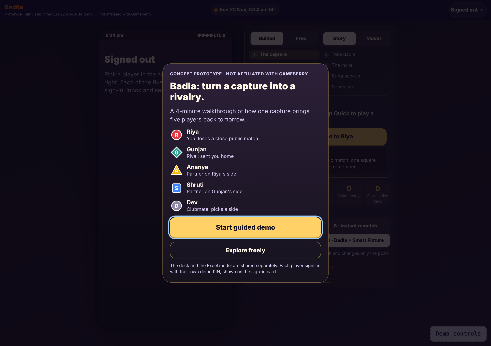 | |

## Commands

Requires Node 20+ (tested on Node 22).

```bash
npm install        # install
npm run dev        # http://localhost:5173
npm run typecheck  # TypeScript
npm test           # Vitest: 10 suites, 77 tests
npm run build      # typecheck + production build into dist/ (static, hash routing, works on Vercel as-is)
npm run preview    # serve dist/
npm run e2e        # Playwright: the whole guided demo on desktop and at 390 px (needs a running server)
```

## The guided demo

On first load the **Welcome** screen shows the cast: Riya (you), Gunjan (rival), Ananya and Shruti (partners), and Dev (clubmate). Choose **Start guided demo**. The **story panel** sits beside the phone, or as a bottom sheet on a phone. It always says whose phone you hold, what is happening, and what to tap next. Its **Why it matters** box links each step to the model.

| Chapter | What happens | Why it matters (model) |
|---|---|---|
| 1 The capture | Riya taps **Quick**, is matched with Gunjan, and rolls and moves. Gunjan's 3 sends her home one square from the finish, with a board shake, a "Sent home!" toast and "😂 so close". Gunjan wins. | The trigger |
| 2 Take Badla | The result screen shows **−100** and the **Badla card**: "Gunjan sent you home 1 square from the finish. Take Badla?" | Card 65% → invite 22% |
| 3 Book tomorrow | Smart Fixture: "You both usually play around 20:00. Book Tomorrow 20:15?", with a confidence pill, two alternatives, **Choose another time**, and Why this? heat strips. | 1.22 extra days per participant |
| 4 The invite | Gunjan is offline, so the panel shows **Gunjan's lock screen** with one push. Tapping it unlocks into Gunjan's session on the invitation (Accept, Suggest another time, Pass). | 0.50 offline pull |
| 5 Fixture day | The **Booked** ticket has one button, **Skip to tomorrow 20:15**. Then "Your table is ready": both check in and Riya wins → 1-1. | Counts only if Gunjan would have skipped (60%) |
| 6 Bring backup | At 1-1 there are three options: **Private decider now**, **Book the decider**, or **Make it a Grudge Night**. Each captain invites a friend, who accepts in her own session. All four confirm. | 0.30 per partner* |
| 7 Grudge Night | The club card appears. Dev picks **Riya & Ananya**, free. Then the story jumps to "Next day, 21:00", all four ready up, and the match is played. | 0.23 per clubmate* |
| 8 Series end | **Riya wins the series 2-1**, with confetti, a whole-series gold receipt and a rivalry card ("Rival since 22 Nov"). Dev sees "You picked Riya & Ananya. Riya & Ananya won." | Lift = participants × extra days ÷ 7.5 |

\* This PDF gives the labels 1.22 / 0.50 / 0.30 / 0.23 but not which step each belongs to. 1.22 and 0.50 are mapped as the PDF says. 0.30 (partners) and 0.23 (clubmates) are my assignment; check them against the Excel model.

**Handoffs keep consent honest.** When the next action belongs to someone else, **Next** shows a 600 ms "Now on Gunjan's phone" card. It then opens the account pane on Gunjan's sign-in card, and **Fill it** enters the demo PIN. Next can also show a lock screen, move the story clock, or pulse the button the player should tap. It never taps Accept, Ready or Pick for anyone.

**Free mode** has no forced steps. The panel shows a checklist of the eight flows seen so far, and you switch players in the top-right account pane.

**Other panel controls:**
- **Let the window close**: the no-show path. Nothing is charged and there is no score change.
- **Experiment arm A/B/C/D**:
  - A: today's result screen only.
  - B: instant rematch, play now only.
  - C: full Badla.
  - D: Badla plus Smart Fixture.

  Switching the arm resets to the match result and changes only the post-match options.
- **Model** tab: the analytics panel (active-day strip, funnel, DAU calculator, guardrails, product-only event log) and live counters (cards shown, challenges, booked, seats ready, extra active days).

## Smart Fixture (mocked, deterministic)

`src/smart/smartFixture.ts` implements the spec's seed data and formulas:

- **Hour profiles:** Riya and Gunjan, from the spec.
- **`pReturnByDay`:** Monday 0.35 for Riya and 0.55 for Gunjan.
- **`scoreSlot`:** `scoreSlot = Π(norm(hourProfile[p])[hour] × showRate[p]) × avg(1 − pReturn[p][day])`.
- **`cardScore`:** closeness plus heat. The card shows at 0.8 because the capture was 1 square from home and there were 3 chats.
- **`inviteLine`:** six templates filled with match facts. The Why panel shows the plain template for comparison.

The copy follows the spec's rules. It says "You both usually play around…", never "AI predicts". There is at most one ✨ tag per screen, and the tags are hidden in arm C. The player can always choose another time.

**One deviation.** The spec's copy says **21:15**, but its own seeded profiles peak at **20:00** for both players. The scoring function therefore recommends **Tomorrow 20:15**, and the push, ticket and skip button show 20:15. To get 21:15, shift each profile by one hour in `hourProfile`.

## Rules engine (unchanged rulings)

These carry over from the Doubles/Grudge Night build:

- **Per-player sessions.** Every player has their own PIN session. Switching happens only in the account pane, which is the only code that calls the sign-in function; a test enforces this.
- **Wallet.** It is a ledger, and balances are derived from it. A round starts with one atomic action that writes all entry debits together. Settlements and refunds are idempotent.
- **Re-acceptance.** If the terms change, earlier acceptances go stale and must be confirmed again. Suggesting another time makes the challenger confirm it.
- **Alerts.** Each player gets at most two Badla alerts a day; further ones wait in the inbox, marked **Delivered tomorrow**.
- **Settings from the player's own UI.** Mute, reminders and block are all set from the ⚙ on the Badla tab.
- **The clock can't settle a game.** The "Skip to tomorrow" button and the story's time jumps only move the clock.

**Gold checkpoints** for the guided path (`tests/guided.test.ts`). Total gold is 5,000 throughout.

| Point | Gunjan | Riya | Ananya | Shruti | Dev |
|---|---|---|---|---|---|
| Start (welcome) | 1,000 | 1,000 | 1,000 | 1,000 | 1,000 |
| After the public match | 1,100 | 900 | 1,000 | 1,000 | 1,000 |
| After round 2 (Riya wins, 1-1) | 900 | 1,100 | 1,000 | 1,000 | 1,000 |
| After Grudge Night (Team Riya 2-1) | 800 | 1,200 | 1,100 | 900 | 1,000 |

The earlier Doubles-first path (Doubles comeback on day 1, then Grudge Night) still works in free mode and under Demo controls → Jump to scene. Its checkpoints are 1,100/900, then 1,000/1,000/1,100/900, then **900/1,100/1,200/800**, now that its decider also goes to Team Riya (`tests/wallet.test.ts`).

## How the two specs were reconciled

- **Ending.** Team Riya wins the decider 2-1, as chosen. The guided decider seed is `decider-riya`.
- **Switching players.** The story panel guides, but players still switch through the account pane, as chosen. "Continue as…" buttons were not added.
- **Grudge Night from singles.** At 1-1 after a singles round 2, Grudge Night is offered and each captain **brings backup**. This replaces the earlier rule that Grudge Night needs a previous Doubles round. A shared club is still required.
- **Start and reset.** Both begin before the public match, with five players at 1,000. The earlier seeded start, with the opening already applied, is scene 1 in Demo controls.
- **Club picks.** Totals stay hidden until the match, per the earlier spec, and the card says "Picks lock at start; totals show after the match". The new spec's per-side pick count before lock was not added.
- **Slot range.** Slots may be today, tomorrow or the day after (the picker's range).
- **Theme.** Deep plum backdrop, gold primary buttons, and ember kept for Badla moments. Token shapes: Riya ●, Gunjan ◆, Ananya ▲, Shruti ■.
- **Not built:**
  - links to the deck and Excel model (no URLs were provided);
  - the separate "Smart Fixture doc" (everything here comes from the build-spec PDF);
  - deploying to Vercel (no access from here; `dist/` is ready to deploy);
  - a real "Start a new series" (it shows a note instead).
- **Daily rewards.** Magic Chest and Lucky Dice show a toast only. There is no shop.

## Code map

```
src/
  engine/     board, rules, dice, fixtures, replay, publicMatch (the scripted capture)
  smart/      smartFixture.ts (deterministic AI mocks)
  domain/     types, time
  state/      reducer, selectors, seed (fresh + settled starts), persistence (badla.v1, v2 root), store
  session/    SessionProvider, AccountPane, SignInCard   ← the only sign-in code
  screens/    Home, PublicMatch, Opening, Challenge, Invite, Booked, Round, Receipt, Booking,
              BadlaHub, Club/Fixture/Inbox, SeriesEnd/Profile
  demo/       StoryPanel, storyline (chapters from live state), guided.ts (scripted path),
              story.ts (Doubles-first path + scenes), DemoDrawer, autoplay, clock
  analytics/  Panel, events, dau
  ui/         Board, Replay, LockScreen, Welcome, Term (jargon tooltips), shell context, kit
tests/        series, round, wallet, consent, engine, fixture, clock, dau, smart, guided
e2e/          journey.cjs
```

Hash routes include `#/welcome`, `#/home`, `#/match/public`, `#/badla/booked/:roundId`, `#/invite/:id`, `#/round/:id`, `#/fixture/:id`, `#/series/:id/end` and `#/profile/rivals`.
