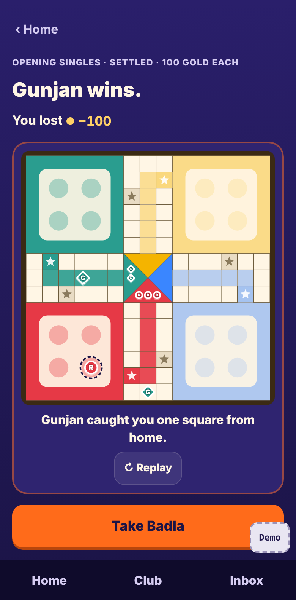
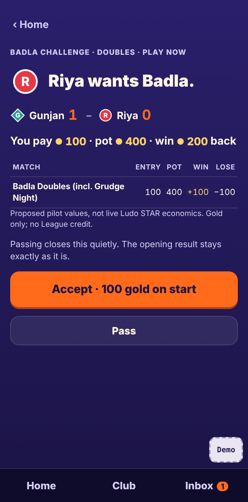
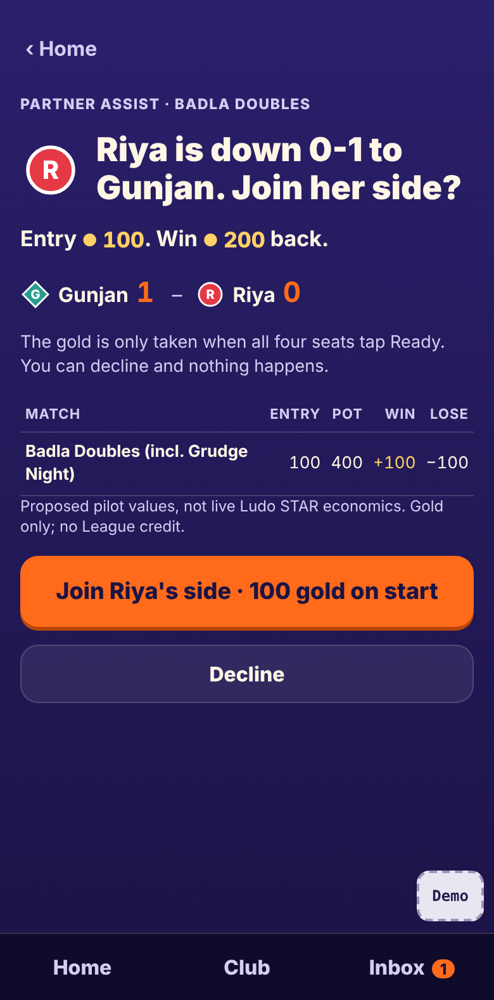
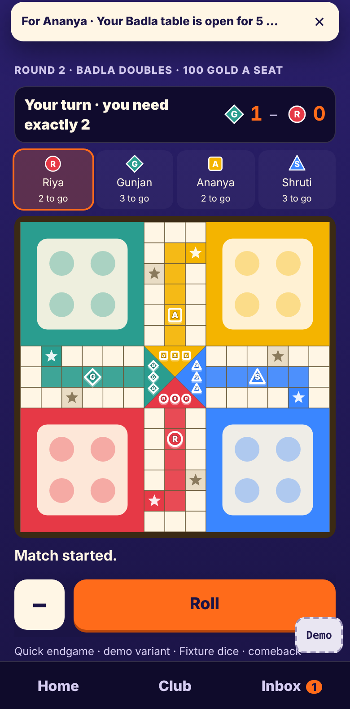
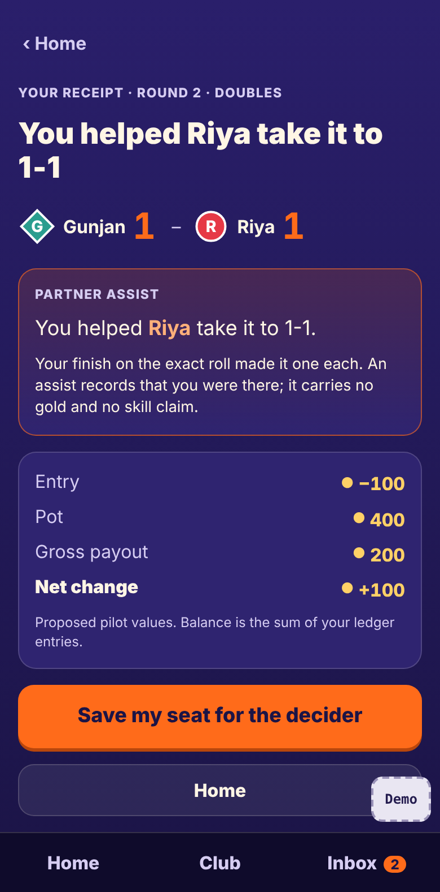
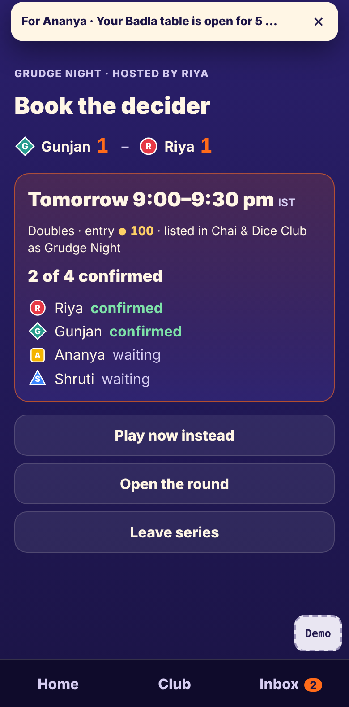
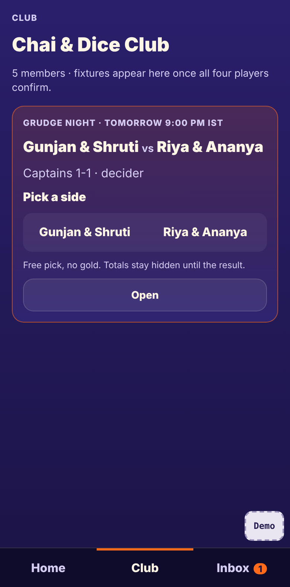
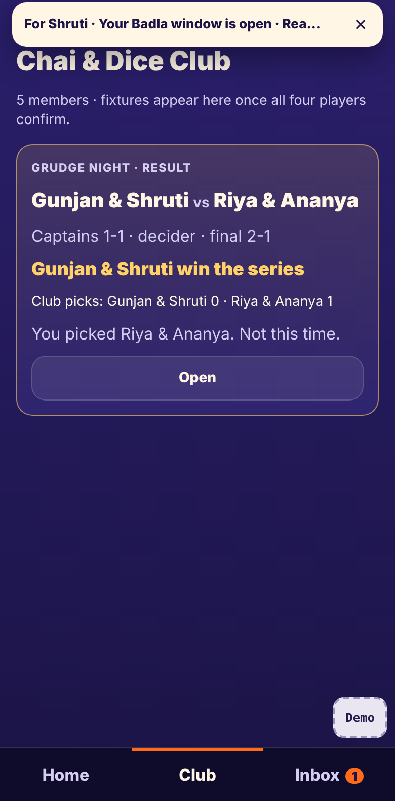
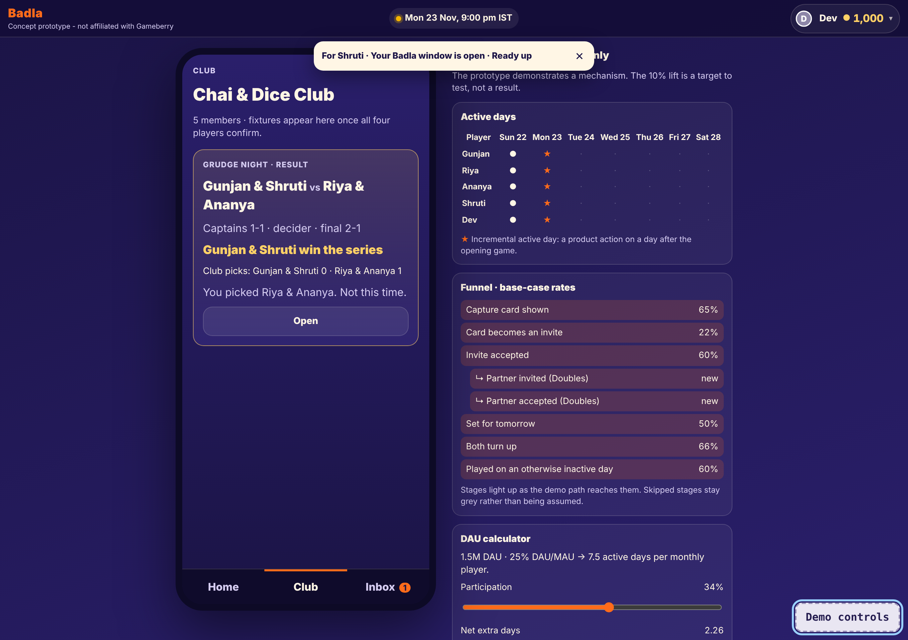

# Badla: Doubles, Partner Assist, Grudge Night

A concept prototype for a Ludo social loop. **Concept prototype, not affiliated with Gameberry.** All artwork is original SVG, nothing leaves the device, and the gold figures are proposed pilot values.

The story runs on one device with five logins over two days. Gunjan beats Riya in a 100-gold singles game. Riya takes Badla and brings Ananya. Gunjan defends and brings Shruti. Riya and Ananya win the Doubles, so the captains sit at 1-1 and Ananya gets a Partner Assist receipt. All four book tomorrow's decider as **Grudge Night**, a club fixture. Dev, a clubmate, picks a side. The next evening Gunjan and Shruti win the decider 2-1, and every wallet and prediction settles.

| 1 · Opening | 3 · Challenge received | 5 · Partner invite | 7 · Doubles endgame |
|---|---|---|---|
|  |  |  |  |
| **8 · Partner Assist** | **9 · Book the decider** | **10 · Club fixture** | **12 · Club result** |
|  |  |  |  |

Desktop: the phone frame with the analytics panel beside it. 

## Commands

Requires Node 20+ (tested on Node 22).

```bash
npm install        # install
npm run dev        # http://localhost:5173
npm run typecheck  # TypeScript
npm test           # Vitest: 8 suites, 66 tests
npm run build      # typecheck + production build into dist/
npm run preview    # serve dist/
npm run e2e        # browser walkthrough of the whole story (needs a running server and `playwright`)
```

## The demo script

Everything you do as a player happens in **that player's own session**. You switch player only through the **account pane** at the top right. No screen in the phone has a "continue as" control. When the next move belongs to someone else, the screen shows who it is waiting on and since when, and the account pane shows a badge on that player.

| # | Sign in as (PIN) | Do |
|---|---|---|
| 1 | Riya (2222) | Home → **See the result · Take Badla**. Watch the capture replay, then **Take Badla**. |
| 2 | Riya | Challenge sheet: **Badla Doubles · You pay 100 · Win 200 back**, Play now, **Send to Gunjan**. |
| 3 | Gunjan (1111) | **Waiting on you → Badla challenge** → **Accept · 100 gold on start**. |
| 4 | Gunjan, then Riya | Seat board **2 of 4 seats filled** → each captain invites one friend (Shruti, Ananya). |
| 5 | Ananya (3333), Shruti (4444) | Each accepts **their own** invitation ("Riya is down 0-1 to Gunjan. Join her side? Entry 100 gold. Win 200 back."). |
| 6 | All four | Waiting table → **Ready · 100 gold**. All four entries are debited together when the last seat is ready. |
| 7 | Riya, Gunjan, Ananya | Each takes their own turn: Roll, then Move. Ananya finishes on the exact 2, so Riya and Ananya win. |
| 8 | Ananya, Shruti, Riya | Receipts: Ananya gets **You helped Riya take it to 1-1** and **Save my seat**. Shruti gets "One each. Defend the series with Gunjan?". Riya gets **Host Grudge Night**. |
| 9 | Riya, then Gunjan, Ananya, Shruti | Riya offers *Tomorrow 9:00–9:30 pm*. Gunjan chooses it (2 of 4), then Ananya and Shruti confirm (4 of 4). |
| 10–11 | Dev (5555) | The club card appears only now. Dev picks **Riya & Ananya**: "Your pick is in. Result tomorrow." |
| 12 | Demo controls → **Jump to tomorrow's slot**, then all four | Predictions lock and check-in opens. Each player taps Ready and plays a turn. Gunjan and Shruti win 2-1. Dev sees "You picked Riya & Ananya. Not this time." |

"Remember this device" is on by default, so each PIN is entered only once. **Lock all sessions** clears them.

**Balance checkpoints.** These are the regression test, and `tests/wallet.test.ts` asserts each row.

| Point | Gunjan | Riya | Ananya | Shruti | Dev | Total |
|---|---|---|---|---|---|---|
| Seeded | 1,000 | 1,000 | 1,000 | 1,000 | 1,000 | 5,000 |
| Opening result applied (start screen) | 1,100 | 900 | 1,000 | 1,000 | 1,000 | 5,000 |
| After the guided Doubles comeback | 1,000 | 1,000 | 1,100 | 900 | 1,000 | 5,000 |
| After the guided decider | 1,100 | 900 | 1,000 | 1,000 | 1,000 | 5,000 |

## Deterministic dice and fixtures

The board is a Quick endgame in a demo variant. Each player has one active token in their own protected lane. One die per turn, no extra turn on a six, finishing needs an exact roll, and an overshoot passes the turn. Turn order is Riya, Gunjan, Ananya, Shruti, so the sides alternate. Partners sit in opposite yards.

The **guided story** uses `comeback` for round 2 and `decider` for round 3. The engine derives every result from these seeds; no screen writes a winner.

| Fixture | Doubles distances (R, G, A, S) | Rolls | Engine result |
|---|---|---|---|
| `comeback` | 2, 3, 2, 3 | 2, 1, 2 | Riya & Ananya win |
| `decider` | 3, 2, 3, 2 | 1, 2, 1, 2 | Gunjan & Shruti win |
| `sweep-gunjan` | 4, 2, 4, 2 | 1, 2, 1, 2 | Gunjan's side (2-0 sweep in round 2) |
| `sweep-riya` | 2, 4, 2, 4 | 2, 1, 2 | Riya's side, straight rolls |
| `decider-riya` | 3, 3, 2, 4 | 3, 1, 2 | Riya's side (alternate decider) |

Every fixture also has a singles script. You choose the fixture for the next round, or **Random dice**, in the Demo drawer. The choice is locked while a match is live. A rolled but unspent die survives a refresh. Optional **auto-play** takes other seats' turns once a human has rolled first. It never starts a round, readies a seat or confirms a booking.

**The opening replay** reads an immutable snapshot of the opening game. In it, Gunjan (teal) rolls 3 from square 34 and lands on Riya's last token. That token is on square 50, the last shared square before Riya's protected lane. `tests/engine.test.ts` replays this through the move rules and checks it. With reduced motion, the replay shows only the final frame, with a caption.

## The consent shortcut

The Demo drawer's **Auto-confirm remaining players** fills outstanding booking confirmations and renews stale acceptances. Every record it creates carries `source: "demo"`, and the analytics panel leaves those records out. It never appears inside a product screen.

## The simulated clock

The clock is seeded at **Sun 22 Nov 2026, 8:14 pm IST** and runs in real time. An amber dot on the clock chip shows when it has been moved off real time. All times are stored as UTC instants and shown in the viewer's zone. Windows include their start and exclude their end.

The Demo drawer has +15 min, +1 hour, Jump to window open, Jump to tomorrow's slot, and Reset to real time.

Time can open and close windows, expire invitations (24 h), lock predictions at the start time, fire reminders, and expire a series after 7 days without a decider. Time **cannot settle a round, decide a board or move gold**. `tests/clock.test.ts` proves this.

## What the reducer guarantees

- **Identity and consent.** Every action takes the actor from the signed-in session, never from the payload.
  - Opening another player's invitation shows it read-only, with "This invitation is for Ananya".
  - Navigation and opening a notification never change consent.
  - Only `src/session/` mentions `signIn`, and a test fails the build if any other file does.
- **One atomic start.** `startRound` checks the whole roster, every acceptance and every balance first. Only then does it write all entry debits.
  - A blocked start names the seat, for example "Shruti needs 100 gold to join".
  - No partial debit is ever written.
- **Idempotency.**
  - Settlement is keyed by round ID and refunds by `roundId:refund:playerId`.
  - A second settle, a repeated finish, a double-tapped start or a duplicate invite does nothing.
- **Gold is conserved.**
  - Balances are never stored; a balance is the sum of the ledger.
  - With the sweep bonus off, balances plus the pot in play equal 5,000 after every action.
  - Balances alone equal 5,000 whenever no round is live.
  - The Demo drawer shows the five balances, the pot and the total.
- **Terms changes force re-acceptance.** Each acceptance stores a terms hash covering format, entry, roster version, timing, slot and club visibility. If any of these change, the seat shows **Terms changed · Confirm again**.
- **Club fixture.** It is published only after four matching confirmations, with at most one live listing per round. Withdrawing it is terminal for that listing. Only club members can see it, and that is checked when the fixture is read. Participants can't predict. Totals stay hidden until the round settles.
- **Notifications.**
  - All notifications are local.
  - Each player gets at most two Badla notifications a day.
  - Muting suppresses notifications but keeps the cards.
  - Blocking ends every Badla link with that player.
  - A notification for someone who isn't signed in shows as a toast on the shell. Tapping the toast opens the account pane with that player highlighted.

## Analytics panel

The panel sits beside the phone, or under it below 900 px. It counts only `source: "product"` events.

- **Active days.** A 7-day strip per player, with a ★ for each incremental active day after the opening game.
- **Funnel.** The base-case rates (65%, 22%, 60%, 50%, 66%, 60%) plus the two Doubles partner stages. Stages light up as the demo path reaches them.
- **DAU calculator.** Lift = participation × extra days / 7.5. The base case is 34% × 2.26, giving **+10.2%**, about **+153K** on 1.5M DAU. Snaps are Low 5.1% and High 16.9%. These are illustrative inputs from the case model, to be replaced with Ludo STAR analytics.
- **Guardrails.** Counters for gold-entry declines, four-seat no-shows, push mutes, blocks and suppressed notifications.
- **Event log.**

## Rulings and deviations

The SOP's rulings were applied throughout: gold stakes, the settled-game trigger, either captain can start, first to two, a five-person cast, and no League credit for Badla rounds. Where the spec left gaps or contradicted itself, this build does the following:

- **Calendar.** 22 Nov 2026 is a Sunday, so the clock reads "Sun 22 Nov", not "Sat".
- **Slot window.** The spec says the host offers up to two slots "inside 24 hours", but its own guided slot (tomorrow 9 pm) is booked about 24¼ hours ahead. Slots are therefore allowed **up to the end of tomorrow**.
- **Conservation.** It is stated as balances plus the pot in play. During a live round, 400 gold sits in the pot, so balances alone can't sum to 5,000 then.
- **Roster changes.** Acceptances tie to a *roster version*, so filling an open seat doesn't make earlier acceptances stale. A replacement, a drop-out or a switch to singles does.
- **`sweep-riya`.** It can't be a true 2-0, because the opening win is Gunjan's. It is a straight-rolls win for Riya's side.
- **Saved seats.** They express interest only, as the SOP currently has it. A Grudge Night decider reuses the previous Doubles pairs, and each of the four confirms the booking.
- **Leaving.** Leaving the series isn't allowed during a live match. "Leave match" voids the round, and every entry is refunded once.
- **Mute vs block.** The earlier spec said muting ends Badla links. Here, **block** ends them and **mute** only suppresses notifications. That matches "mutes leave the lobby card available".
- **Single offered slot.** When the host offers exactly one slot, that offer counts as the host's confirmation of it once it is chosen.

## Code map

```
src/
  engine/     board.ts (geometry, routes), rules.ts, dice.ts, fixtures.ts, replay.ts
  domain/     types.ts, time.ts
  state/      reducer.ts, selectors.ts, seed.ts, persistence.ts (badla.v1), store.tsx
  session/    SessionProvider.tsx, AccountPane.tsx, SignInCard.tsx   ← the only signIn
  screens/    Home, Opening (1/1b), Challenge (2), Invite (3/5), Round (4/6/7), Receipt (8),
              Booking (9), Club + Fixture (10–12), Inbox
  demo/       DemoDrawer.tsx, story.ts (guided script + 12 scenes), clock.ts, autoplay.ts
  analytics/  events.ts, dau.ts, Panel.tsx
  ui/         Board.tsx, Replay.tsx, kit.tsx
tests/        series, round, wallet, consent, engine, fixture, clock, dau
e2e/          journey.cjs (Playwright walkthrough)
```

Deep links are hash routes: `#/invite/<id>`, `#/round/<id>`, `#/fixture/<id>` and `#/receipt/<roundId>`. Opening a link re-checks it against the current state and the signed-in player.
