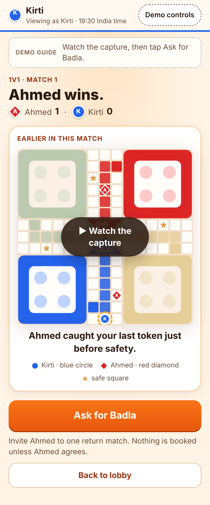
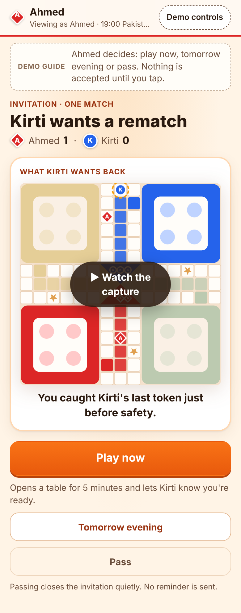

# Badla Ludo prototypes

Badla Rivals is a playable singles rivalry demo with Riya and Gunjan. The repository also includes the earlier Doubles and Grudge Night walkthrough. Player profiles, matches, invitations, reminders and analytics are simulated on one device.

## Run the prototype

Use Node 24 or newer.

```bash
npm ci
npm run dev
npm run typecheck
npm test
npm run build
npm run preview
```

The default route opens Badla Rivals. Use **Demo controls → Doubles & Grudge Night** or open `?series=1` for the team demo. The original Kirti and Ahmed flow lives at `?classic=1`. Each mode has its own versioned local storage.

## Badla Rivals walkthrough

1. The lobby opens as **Riya**. Open her player card for her profile, then select **Play 1v1**. Roll and move token 4.
2. Select **Demo controls → View as Gunjan** in the phone's top-right corner. Roll and move Gunjan's token 4. The Kaat replay records the 41-square capture from the move the board just played.
3. Switch back to Riya. **Finish remaining demo turns** plays the rest of the guided opening through legal moves. Open the result and select **Ask for Badla**.
4. Switch to Gunjan. Select **Kal Milte Hain**, then switch back to Riya and choose **Confirm appointment**. Either can suggest a different two-hour window before check-in.
5. Use **Demo controls → Skip to tomorrow**. Open the simulated notification as Riya, then tap **I’m ready**. Switch to Gunjan and check in independently.
6. Back as Riya, roll 2 and move token 4 home. Open the 1–1 result, choose a preset sticker, and inspect the rivalry ledger or invite Gunjan to a decider.
7. Open **Rivals → Shruti** to try the weekly Derby and board theme on a seeded Nemesis account.

The PM panel shows the event log, each player's active days, the illustrative funnel and the DAU calculator. Opening an agreed window on a new local day records the incremental visit. The base model displays +10.2% and +153K DAU. The low and high presets display +5.1% and +16.9%.

**Demo controls** also offers reduced motion, sound and optional Gunjan auto-play. Turn off **Demo dice and starting positions** before starting a table to play all four tokens from the yards with a fresh dice sequence. The guided match positions and roll sequence make the capture and rematch reproducible. The demo clock advances through explicit controls.

Run `npm run e2e:rivals` against a running Vite server with Playwright and Chromium installed. The test runs the Riya and Gunjan handoff at 360 px and checks the side panel and Derby at 1280 px. Set `BASE_URL` or `CHROMIUM_PATH` for an alternate server or browser installation.

## Doubles and Grudge Night

## The guided two-day story

1. As **Riya**, replay Gunjan's legal capture on the opening result. Tap **Take Badla → Bring backup · 2v2 → Play now → Send challenge**. Use **Continue as Gunjan** and accept his invitation as Gunjan.
2. Invite **Shruti** on Gunjan's side and **Ananya** on Riya's side. Switch to each partner to accept. Every player then taps **Ready**. Use **Continue as** or the **View as** buttons inside Demo controls to reach any outstanding seat.
3. Roll and tap the highlighted token as **Riya**, **Gunjan**, then **Ananya**. Tap **View result** after seeing Ananya bring her token home. Her receipt shows +200 from the pot and +100 net. Save her seat for the decider and continue as either captain.
4. Tap **Host Grudge Night**, offer tomorrow's slot (with an optional second slot), and switch to the other captain to choose it. All four individually confirm the selected time, 100-gold entry and club visibility. The fourth confirmation publishes the fixture.
5. Continue as **Dev**, open the club fixture and pick a side. You can change the pick until the slot starts. Use **Demo controls → Advance to scheduled start**. Switch to a participant and use **Open your table** from the fixture or the lobby. Each of the four players checks in separately.
6. Play the decider in order **Riya → Gunjan → Ananya → Shruti**. Open the result as Dev to see the actual winners, both prediction counts and your verdict. Captains and partners can open their own receipts from the lobby.

With the bonus disabled, the balance changes are:

| Stage | Gunjan | Riya | Ananya | Shruti | Dev |
| --- | ---: | ---: | ---: | ---: | ---: |
| Opening settled | 1,100 | 900 | 1,000 | 1,000 | 1,000 |
| After the comeback | 1,000 | 1,000 | 1,100 | 900 | 1,000 |
| After the decider | 1,100 | 900 | 1,000 | 1,000 | 1,000 |

### Demo controls and other paths

- **Identity and consent.** Role switching and opening a local inbox card only change the view. Each confirmation and check-in is a separate action by that player. Saving a seat records interest in the decider and carries no gold.
- **Time.** The running demo clock begins at 19:30 IST on 22 November 2026. Use the drawer to jump to a scheduled start, skip to the window close, or advance in increments. Slots are stored as UTC instants and displayed in IST for the seeded players. Check-in includes the start and excludes the end. Immediate tables have five minutes. Scheduled tables have 30 minutes.
- **Board.** The Quick endgame starts each player with one pawn in their protected lane and requires an exact roll to finish. The guided Doubles rematch uses distances `[2,3,2,3]` and rolls `[2,1,2]`. The guided Doubles decider uses distances `[3,2,3,2]` and rolls `[1,2,1,2]`. Singles starts at `[4,5]` and uses `[2,3,2]`. The drawer's seed 14 reverses the guided winner in both Doubles rounds and gives Gunjan the singles sweep. The dice state and any pending roll survive refresh.
- **Gold and recovery.** Enable the optional sweep bonus before either captain begins the series. A bonus is game-funded and separate from the pot. The drawer can lower a player's gold, change club membership, mute reminders, block the captains, or void an active table to exercise recovery paths. A withdrawn club booking can be followed by a private decider with fresh player confirmation. **Meera** is a replacement partner outside the club by default.
- **Browser verification.** With Vite running, use `npm exec --package=playwright -- playwright install chromium` to install Chromium and make the `playwright` package available to the test (for example, `npm install --no-save --package-lock=false playwright`). Run `npm run e2e:series`. Set `BASE_URL` to point at another server or `CHROMIUM_PATH` to use an installed Chromium. The walkthrough uses a 360 px viewport, reduced motion, keyboard board input, reloads, and a stale inbox link.

### Measuring the DAU hypothesis

The drawer exposes local product events for invitation origin, partner acceptance, confirmed bookings, next-day check-ins, completed rounds, unique predictors and club result opens. Identity changes, clock advances and test fixtures stay out of those events. Dates are UTC and active player-days count each person once per day. In a later four-week pilot, compare average daily unique active users with a standard-result holdout using the same active-user definition and assign connected groups together where feasible. Track occasional partners and clubmates returning on a day they would otherwise skip, plus displaced normal matches, gold-entry declines and failed check-ins. The 10% lift is a pilot target.

---

## Original singles demo


**Badla** is a return match that both players agree to. When a close 1v1 ends, the player who was caught can attach that one capture to an invitation. The opponent can play now, choose a time tomorrow evening, or pass. If they agree, both players come back, play the match, and the head-to-head score updates.

This repo is a **single-device case-study demo**. It has two fictional accounts (Kirti and Ahmed), a demo clock you can control and a local notification inbox. You don't sign in, invite anyone, grant permissions or wait until tomorrow. It doesn't use external APIs or any Gameberry systems. It is not the live game, and the in-app demo controls say so ("Playable concept").

| Original result | Ahmed's invitation | Kirti confirms | Reminder | Rematch | One each |
|---|---|---|---|---|---|
|  |  |  |  |  |  |

## Commands

Requires Node 20+ (tested on Node 22).

```bash
npm install          # install
npm run dev          # dev server at http://localhost:5173
npm run typecheck    # TypeScript, no emit
npm test             # Vitest (domain, board, persistence, UI)
npm run build        # typecheck + production build into dist/
npm run preview      # serve dist/
npm run e2e          # browser walkthrough (needs a running server and the `playwright` package)
```

`dist/` uses relative asset paths, so any static host (or a phone's browser) can open it.

## The guided story (about 3 minutes)

1. **Kirti, 22 Nov, 19:30 India time.** "Ahmed wins." with *Ahmed 1 · Kirti 0*. The hero card replays the capture from earlier in that match: *"Ahmed caught your last token just before safety."* Tap **Ask for Badla**.
2. The lobby card reads *"You challenged Ahmed."* with Withdraw and Watch replay. The **Demo guide** bar offers **Try Ahmed's view**.
3. **Ahmed** sees *"Kirti wants a rematch"* with the same capture from his side ("You caught Kirti's last token…"), shown on a board rotated to his seat. He picks **Tomorrow evening**: 19:00–19:30 Pakistan time, which Kirti sees as 19:30–20:00 India time.
4. Back with **Kirti**, she taps **Confirm time**. Only her confirmation books the match.
5. **Advance to agreed time.** Ahmed taps **I'm ready**. Kirti gets one simulated reminder: *"Ahmed is ready for your Badla match."* Tapping it rechecks the state and opens the shared table. Then **Join match**.
6. **Quick-style endgame.** You play Kirti's turns, and a labelled demo opponent plays Ahmed's turns with the same rules. With the guided seed, Kirti wins.
7. **"One each. Play the decider?"** with *Ahmed 1 · Kirti 1*. The decider needs Ahmed to accept again. Choose Play now for him, and Kirti joins match 3.

**The Play now path** uses no clock controls. Ahmed taps Play now, which marks him ready and opens a 5-minute table. Kirti joins from the notification or dismisses it with "Not now".

## Demo controls

The **Demo controls** button sits top right. Its badge shows the active identity's unread notifications.

- **View as Kirti / Ahmed.** Both views read the same stored state. The active identity always shows in the header.
- **Opponent response: Guided / Manual.** Guided shows a handoff prompt when the next move belongs to the other player. It never acts for that player: you tap every choice yourself. Manual shows no prompts.
- **Clock.** The demo clock runs in real time from 22 Nov 2026, 14:00 UTC. Buttons: *Advance to agreed time*, +5 min, +1 h, +1 day. Each advance rechecks expiries.
- **Notification inbox.** Local entries keyed by invitation ID.
- **Dice for the next match.** *Guided seed (2, 3, 2)* or *Fresh dice*. This is locked while a match is running.
- **Motion.** System, Reduced or Full.
- **Reset demo.** Restores the original state: Ahmed's single recorded win and nothing else.
- **Event log.** Output from the analytics adapter, with active player-days. It lives only in the demo controls and players never see it.

## Choices made for the demo only

- **Two fictional, eligible accounts on one device.** Production would authenticate both players and check Game Buddy and 1v1 eligibility.
- **Reconstructed screens.** The result screen, lobby and match handoff are plausible reconstructions, not the real Ludo STAR layout. All artwork is original SVG, and fonts are system fonts.
- **Quick-style endgame instead of Quick mode.** Each side starts with three tokens home and one token in its own protected lane. Kirti needs exactly 4 and Ahmed exactly 5. Kirti moves first, with one die per turn and no extra turns. A roll that overshoots passes the turn and the screen explains why. Finished tokens stay visible in the centre.
  - The guided seed runs Kirti 2, Ahmed 3, Kirti 2, so Kirti wins.
  - *Fresh dice* uses a seeded RNG (mulberry32) whose state is saved after every roll.
  - Seed **5** is the tested alternate: Kirti rolls 5 and overshoots, then Ahmed rolls exactly 5 and wins.
- **Look and feel.** The app is styled as an in-game screen: dark backdrop, the conventional board layout (green top-left, yellow top-right, blue bottom-right, red bottom-left), each player's avatar with a dice box beside it (you tap your dice to roll), and a glowing ring on whoever's turn it is. Kirti plays red from the bottom-left and Ahmed yellow from the top-right; each player's view rotates the board so their own seat sits at the bottom. All artwork, tokens, dice and colours are original, and the screen does not copy Ludo STAR's own visual assets or branding.
- **Fixed score order.** Every view lists *Ahmed · Kirti* (`SCORE_ORDER`), matching the brief's first-screen copy.
- **Board geometry.** The board is the conventional 15 × 15 cross with a 52-square loop. Where the arms meet the centre, the track takes the usual diagonal step at each corner, and `validateRoute` allows only that diagonal. Safe squares are the four start squares and four stars, at loop indices 0, 8, 13, 21, 26, 34, 39 and 47.
- **The capture fixture** (`src/board/replay.ts`):
  - Kirti (red, bottom-left) is on route square 50. That is her last shared-track square, and the next step is her protected lane.
  - Ahmed (yellow, top-right) starts on his square 21 and rolls a 3 through 22 and 23 to 24. That lands on the same loop square from behind.
  - The engine test replays this through `applyMove` and checks each claim:
    - the destination is shared and unprotected;
    - Kirti's single token is the only one there;
    - Ahmed's other tokens are off the track.
  - The capture happened earlier in the match, before Ahmed's win.
- **Replay copy is derived from the event data.** "last token" and "just before safety" appear only when the stored event supports them. A finishing move reads "brought … last token home first". The replay plays from a stored snapshot and never changes live state or the record.
- **Notifications are in-app simulations.** Each player gets at most one readiness reminder per invitation. A reminder is suppressed when the recipient has muted reminders, when the pair is blocked, when the invitation is closed or when it would be a duplicate. Opening the app never notifies anyone.
- **Persistence is versioned `localStorage`** (`badla-demo`). The snapshot is validated before it is restored. If it fails, the app offers a reset and doesn't overwrite the saved data until you choose to.

## Rules implemented

- **Challenge lifecycle.** States run `pending → proposed → scheduled → waiting → playing → completed`. Play now goes straight from `pending` to `waiting`.
- **Terminal states.** These are `declined`, `withdrawn`, `expired`, `cancelled`, `missed`, `blocked`, `abandoned` and `completed`. A terminal invitation can't be revived, including from a stale notification.
- **Permissions.** Only the invitee can play now, propose a time or pass. Only the challenger can confirm, decline or withdraw. Either player can cancel a booked match before it starts.
- **Invitation limits.** Each completed match gets one invitation, and only one invitation can be open at a time. A new invitation for the same match is allowed only after a no-fault outcome: missed, an agreed window nobody used, or an abandoned match.
- **Time.** Windows are stored as UTC instants and formatted with `Intl.DateTimeFormat` in each player's zone. Intervals include the start and exclude the end.
  - Pending invitations expire after 24 h.
  - Proposals expire after 24 h or at the window start, whichever comes first.
  - A seat is held for 5 minutes or until the window ends, whichever comes first. A player can mark ready again while the window is open.
  - If a window closes with one player ready, the card says "You missed each other". There is no score change.
- **Matches.** Both players joining while their readiness overlaps creates exactly one match. A result is recorded once per match ID. Double taps, stale rolls, refreshes, repeated completions and abandoned matches can't add a win.

## Code map

| Part | File(s) |
|---|---|
| Domain reducer (transitions, permissions, clock, score) | `src/domain/reducer.ts`, `selectors.ts`, `types.ts` |
| Time and zones | `src/domain/time.ts` |
| Board geometry, movement, dice, replay frames | `src/board/geometry.ts`, `engine.ts`, `dice.ts`, `replay.ts` |
| Notification adapter | `src/domain/notifications.ts` |
| Analytics adapter | `src/domain/analytics.ts` |
| Persistence | `src/persistence/storage.ts` |
| Screens | `src/ui/screens/*` (Result, Lobby, Invite, Table, Match, Rivalry) |
| Store, navigation, demo guide | `src/ui/store.ts`, `navigation.ts`, `guide.ts` |
| Tests | `src/**/*.test.ts(x)`, `e2e/journey.cjs` |

**Analytics.** Each committed player action logs exactly one `player` event; Ahmed's scripted moves log as `demo-opponent`. Consequences are logged as `system` events, such as a reminder delivered or suppressed, an expiry, both players joining, a completed match or an accepted decider. Demo controls log as `demo` and replay views as `replay`. Dates use UTC. `activePlayerDays` counts distinct (player, date) pairs from player actions. A reminder, an acceptance and a match on the same date count as one active day.

## Production handoff (not built here)

- Authenticate both players, and take the capture and result from the authoritative match log.
- Store agreed UTC windows server-side, check readiness again at join, and hand the private pair to the existing Quick matchmaking.
- Use idempotent writes keyed by challenge and match IDs, and decide reminder eligibility on the server, respecting mute, block and online-status privacy.
